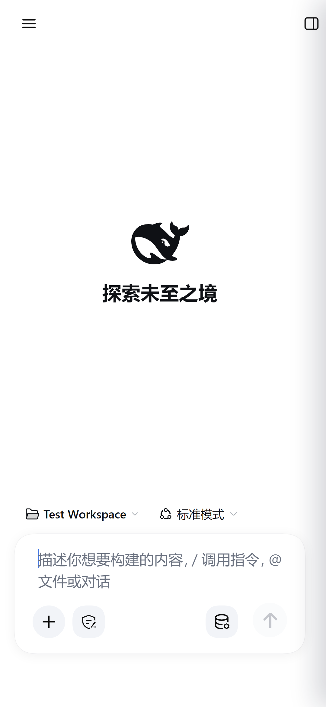
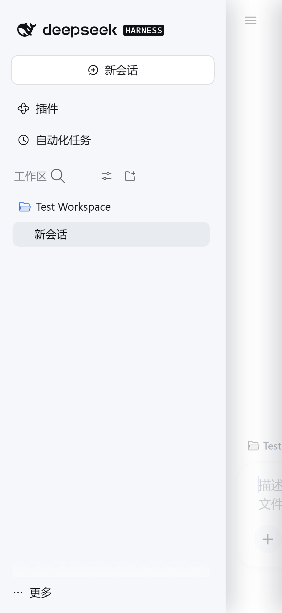
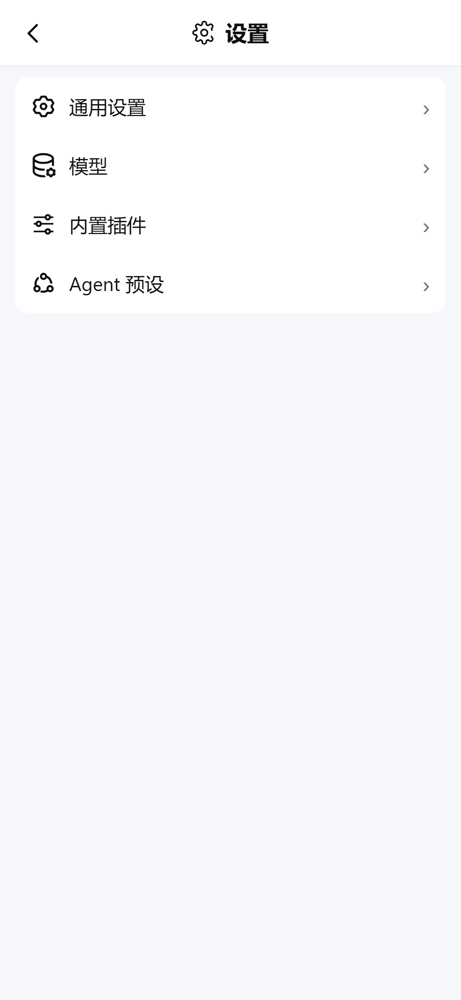
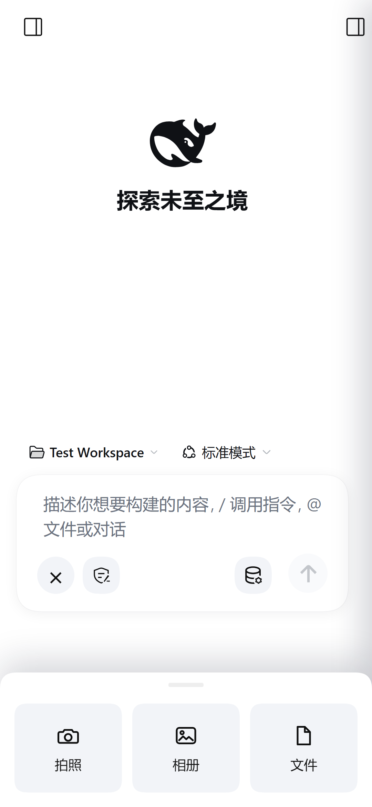

# dsh-mobile-shell

**DeepSeek App-style mobile shell for the DSH Web UI.**
为 DSH Web 界面提供接近官方 DeepSeek App 的竖屏手机壳层。

> 本项目是非官方 DSH 插件，与 DeepSeek 无隶属关系。

## 推荐搭配 dsh-android / Recommended with dsh-android

**搭配 [dsh-android](https://github.com/Htao-uu/dsh-android) 使用效果最好。**
dsh-mobile-shell 单独安装在 DSH Web UI 里也能工作 **(可能存在BUG,不建议单独安装)** ，但只负责移动端壳层；只有配合 dsh-android，
才能同时获得原生相机/相册、最近照片、全屏 WebView、Android 返回键、内置运行时和完整的设置页适配。

- App 与最新 APK：https://github.com/Htao-uu/dsh-android/releases/tag/v1.4.0
- App 源码：https://github.com/Htao-uu/dsh-android
- 推荐组合：**dsh-android 1.4.0 + dsh-mobile-shell 0.7.5+**

**Best paired with [dsh-android](https://github.com/Htao-uu/dsh-android).**
The plugin also works as a standalone DSH Web UI plugin, but the native camera/gallery,
recent-photo strip, full-screen WebView, Android back handling, embedded runtime and the complete
settings adaptation come from the app.

- Latest APK: https://github.com/Htao-uu/dsh-android/releases/tag/v1.4.0
- App source: https://github.com/Htao-uu/dsh-android
- Recommended bundle: **dsh-android 1.4.0 + dsh-mobile-shell 0.7.5+**

## Overview / 概述

dsh-mobile-shell 是一个纯客户端的 DSH Web UI 插件：在窄屏（≤1023px）下把宿主界面整理成接近官方 App 的手机体验，桌面端不做任何改动。

目前该插件正在快速迭代,存在许多BUG与体验不佳的交互,欢迎提交issue

## Screenshots / 截图

以下截图来自独立 demo profile（Test Workspace，360×780 CSS px，1080×2340 输出），不含真实会话数据。

| 首页 | 左侧抽屉 | 设置 | 附件弹层 |
| --- | --- | --- | --- |
|  |  |  |  |

## Features / 功能

- **移动壳层**：隐藏常驻左侧图标栏，顶栏提供 ☰、右侧详情、新建会话入口。
- **官方式抽屉**：左右两侧均为 80% 屏宽的 carousel 抽屉，页面 1:1 推移并淡出；支持全屏跟手拖动、50% 行程 / 125px/s 速度判定、spring 收尾。
- **App 风格输入卡**：28px 圆角、轻阴影、圆形发送/停止按钮、胶囊式权限/模型控件；输入字号 16px。
- **附件弹层**：composer 的「+」打开底部附件弹层（拍照 / 相册 / 文件，系统选择器），可选接入原生桥显示「最近照片」；桥不存在时该区域自动隐藏。
- **设置页**：全屏设置面板、返回箭头、紧凑分组列表。
- **返回栈**：Android 返回键依次关闭 附件弹层 → 设置 → 右抽屉 → 左抽屉，再交给宿主默认行为。
- **桌面端零影响**：≥1024px 时插件不生效。

## Install / 安装

```sh
dsh plugin --profile <profile> add dsh-mobile-shell
# 或在 DSH Web UI：设置 → 插件 → 添加插件 → dsh-mobile-shell
# 安装后重启一次 harness
dsh --profile <profile> web
```

本地开发可用：

```sh
dsh plugin --profile <profile> add link:/path/to/dsh-mobile-shell
```

## Native bridge / 原生桥

「最近照片」依赖可选的 `window.DSHNative` 接口；插件在接口不存在、超时或无权限时会隐藏该区域，DSH 其余功能不受影响。

协议见 [docs/ANDROID-BRIDGE.md](docs/ANDROID-BRIDGE.md)。

## Development / 开发

```sh
npm run build
```

浏览器 bundle 提交在 `lib/client.js`；修改 `src/` 后重新构建。若运行环境没有 pnpm，可把仓库复制到
`<DSH_HOME>/profiles/<profile>/node_modules/dsh-mobile-shell` 并重启一次。

更多文档：

- [docs/WORKFLOW.md](docs/WORKFLOW.md) — 开发、安装与验收流程
- [docs/DESIGN.md](docs/DESIGN.md) — 设计 token、壳层映射与交互约束
- [docs/GLOSSARY.md](docs/GLOSSARY.md) — 中英术语表

## License / 许可

MIT License, Copyright (c) 2026 **Htao-uu**.

你可以自由使用、修改、分发本项目（包括商业用途），但必须保留版权声明、`LICENSE` 文件和作者署名 **Htao-uu**。软件按“现状”提供，不附带任何明示或暗示的担保。

This project is licensed under the MIT License. You may use, modify and distribute it (including commercially), provided that the copyright notice, the `LICENSE` file, and the attribution to **Htao-uu** are retained. The software is provided "AS IS", without warranty of any kind.

DeepSeek、DeepSeek Harness 等名称与商标归其各自权利人所有。

GitHub: https://github.com/Htao-uu/dsh-mobile-shell
