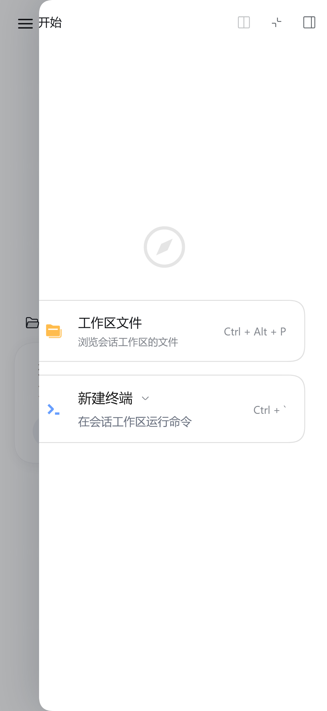

# dsh-mobile-shell

**DeepSeek App-style mobile shell for the DSH Web UI.**
为 DSH Web 界面提供接近官方 DeepSeek App 的竖屏手机壳层：抽屉导航、官方风格的顶栏 / 输入卡 / 设置页，以及一条可预测的 Android 返回栈。


## What it does / 功能

- **Mobile shell / 移动壳层**：窄屏（≤1023px）隐藏常驻左侧图标栏，把宿主左栏变成 88vw 左侧抽屉；顶栏提供 ☰、右侧详情、＋新建三个入口。
- **Right details drawer / 右侧详情抽屉**：宿主右侧栏（工作区文件、终端、Agent 浏览器）改为从右侧拉出的抽屉，保留约 12% 左侧页面可见。
- **App-style composer / 官方风格输入卡**：28px 圆角、轻阴影、圆形发送/停止按钮、胶囊式权限/模型控件；输入区字号 16px，避免移动端自动放大。
- **App-style settings / 官方风格设置页**：全屏设置面板、返回箭头、横向分类胶囊、白色分组卡片。
- **Edge gestures / 边缘手势**：左边缘右滑开左抽屉，右边缘左滑开右抽屉；轴锁避免与纵向滚动冲突。
- **Back stack / 返回栈**：Android 返回键依次关闭 设置 → 右抽屉 → 左抽屉，再交给宿主默认行为。
- **Desktop no-op / 桌面端零影响**：≥1024px 时所有按钮、遮罩、手势均不生效。

| 左侧抽屉 | 设置 | 右侧抽屉 |
| --- | --- | --- |
|  |  |  |

## 0.6.0 变更

- composer 的「+」改为官方风格底部附件弹层：+ 变 ×，点 × / 点空白关闭；拍照、相册、文件三个入口（系统选择器）。
- 「最近照片」通过可选原生桥 `window.DSHNative` 获取：桥不存在、超时或无权限时**整个最近照片区域隐藏**，其余功能与 DSH 正常工作不受影响。协议见 docs/ANDROID-BRIDGE.md。
- 选中的图片/文件通过宿主输入框的粘贴/拖拽通道进入原生草稿上传（任意文件类型）；前端校验单文件 ≤1GB、单次总计 ≤5GB。
- 修复打开「设置」时「通用设置」内容在页面下半部分闪现的问题：设置内容默认隐藏，面板一出现立即切到列表态。

## 0.5.4 变更

- 修复「先开右抽屉→关右抽屉→开左抽屉」后左抽屉持续空白：宿主在右抽屉开合期间会收起侧栏，插件的常驻预加载与宿主状态互相打架。现在右侧开合期间不再抢着展开左栏，右抽屉结束后才检查；左抽屉打开时还加了修复看门狗，若宿主侧栏没恢复挂载会持续重试，并清掉残留的屏外锁定 class。
- 新增抽屉移动速度上限：约 2300px/s（60fps 下约 38px/帧），快速甩动时不再一帧跳出大半屏，改为受控追赶；跟手、spring 收尾、关闭统一限速。

## 0.5.3 变更

- 侧栏改为「常驻预加载」：启动后让宿主侧栏保持挂载并固定在屏外，抽屉开合只移动它，不再每次展开都重新挂载/加载数据。修复快速滑动和慢速拖动时侧栏反复出现骨架屏（微信/鲸鱼占位、空白行）的闪烁。
- 左抽屉显隐改由插件自己的状态控制（dms-left-open / dms-left-hide / dms-preload-left），宿主保持展开但屏外。

## 0.5.2 变更

- 手势防闪屏修正：挂载抽屉后一旦拿到真实元素就立刻解除屏外锁定并写入跟手 transform，不再把手势结束才解除；挂载轮询延长到约 2s。修复快速滑动时页面已推开、侧栏却一直空白到手势结束才出现的问题。

## 0.5.1 变更

- 底部统计：恢复「轮/步」「tok/s」「缓存命中」之间的空格（用不可见分隔元素占位，不再粘连）。
- 手势防闪屏：手势开始挂载抽屉时先锁定到屏外（arming class），直到首帧 compositor transform 写入；修复快速猛拉/小距离慢拖时抽屉瞬白、阴影消失的问题。

## 0.5.0 变更（按官方 60fps 录屏复核后实现）

- 左/右抽屉统一为官方 carousel 交互：80% 屏宽（上限 326px）。
- 页面随抽屉 1:1 推移，并淡出到 0.3（opacity = 1 − 0.7 × 进度）；无黑色遮罩、无缩放。
- 位置阈值 50%，速度阈值 125px/s，收尾 spring(0.9,1500)（rAF 积分）。
- 抽屉视觉按官方：直边 + 边缘阴影，无圆角；透明点击层点页面关闭。
- 全屏横向拖拽：右滑开左抽屉、左滑开右抽屉；打开后反向拖动关闭，点页面/返回键关闭。
- 移除上一版的 12% 位移、深色 scrim、关闭冷却和右抽屉边缘限制。
- 官方行为通过 scrcpy 60fps 录屏 + 像素轨迹复核（报告：devtools/OFFICIAL-DRAWER-BEHAVIOR-REVIEW.md）。

## 0.4.0 变更（按官方 App 反混淆源码对齐）

官方实现（`apk-deepseek/deobf`）：

- `DSNavigationDrawer.kt` / `ModalNavigationDrawer.kt` / `ChatDrawerHost.kt`：Jetpack Compose 的 `SwipeableState` 抽屉。
- 抽屉宽度 **326dp**（`nh3.java` 中 `326.0f`）。
- 位置阈值 **50%**（`bz3.java` 返回 `f * 0.5f`）。
- 速度阈值 **125dp/s**（Compose SwipeableDefaults）。
- 收尾动画 **spring(dampingRatio=0.9, stiffness=1500)**（`ModalNavigationDrawerKt.a = s3a(0.9f, 1500f)`）。
- 拖动全程跟随手指，scrim 透明度 = 抽屉进度（`ModalNavigationDrawerKt.c`）。
- 全屏触发（SwipeableState 修饰符挂在整页容器上）。

本插件已按这些参数重写：抽屉宽度 326px（上限 90.6vw）、50% 行程/125px/s 速度判定、requestAnimationFrame spring 收尾、拖动期间直接写 compositor transform 并暂停宿主动画、scrim 线性跟随；主面板（插件/终端）仍禁用滑动。

## 0.3.3 变更

- 对话消息列表左右内边距与输入卡外边距对齐（消息宽度 = 输入框宽度）。

## 0.3.2 变更

- 工作区标题行按宿主真实结构重新适配：搜索/筛选/添加三个按钮完整显示并右对齐。
- 会话底部统计按宿主 StatsPills 结构压缩：字号 10px、去分隔点、图标 10px，三部分可完整显示。
- 设置说明文字占满整行（宿主 48px 右侧预留导致提前换行的问题已修）。
- 手势改为直接对抽屉元素写 compositor transform（不再逐帧触发整页样式重算），保留跟手、速度判定和 250ms tween 收尾；插件/终端等主面板继续禁用手势。
- 插件市场等整页 section 的内边距/滚动限制移除，避免内容被固定区遮挡。

## 0.3.1 变更

- 主面板（插件、终端、插件市场等）不再被手机顶栏样式挤压，页面标题/工具条恢复正常；插件市场页不再被固定区遮挡。
- 左抽屉工作区标题行完整显示 搜索/筛选/添加 三个按钮。
- 抽屉内会话行操作按钮移除，改为长按弹出会话菜单。
- 设置列表改为整块无间隙分组，更紧凑；恢复宿主自带图标逻辑，插件自带图标时不再多出齿轮。
- 通用设置说明文字不再提前换行，选项高度调整。
- 手势改为 rAF 跟手拖动 + 速度判定 + 页面微缩放/遮罩联动；插件/终端等主面板禁用左右滑动手势。
- 会话底部统计更紧凑并去掉「·」分隔符。

## 0.3.0 变更

- 主界面输入卡固定在底部（与官方 App 一致），问候语居中。
- 全屏手势：任意位置左右滑都能拖动抽屉跟手位移，松手按行程开/关（不再是固定阈值动画）。
- 返回键：无浮层时首次提示「再按一次退出」，2 秒内再按退出 App。
- 设置列表更紧凑；修复右侧选项被裁切；主题/按钮恢复 DSH 风格；「模型」页按钮尺寸与添加提供商表单恢复正常，保存按钮 DSH 风格。
- 左抽屉工作区右侧图标完整显示；插件入口不再多出齿轮图标。
- 会话底部统计行压缩为单行省略；输入卡权限/模型按钮清除残留文字。
- 长按会话/列表行/消息可打开对应操作菜单（hover 操作触屏化）。

## 0.2.0 变更

- 手机状态栏避让：整页（含插件页/设置页）下移一个安全区高度。
- 顶栏按钮改用 DSH 自身图标风格；主界面隐藏无意义的「＋」，右侧留出边距。
- 输入卡：恢复 DSH 默认占位文字；权限/模型改为 DSH 风格圆形图标按钮（无文字、无箭头）。
- 设置页重做为「竖排分组列表 → 二级页」：齿轮标题、返回箭头、无横向滚动、选项单行不换行。
- 侧边栏：新会话按钮恢复宿主样式并居中；点击功能入口自动收起抽屉；工作区图标不再被裁切。
- 返回键：新增主面板（如插件页）返回会话的处理。
- 右侧抽屉：内容宽度适配抽屉，不再被裁切。
- 侧边栏会话支持长按打开操作菜单。

## Install / 安装

要求：DSH Web 0.2.x，目标浏览器为手机 WebView 或移动视口。

### 从 npm 安装（推荐）

```sh
dsh plugin --profile <profile> add dsh-mobile-shell
# 或在 DSH Web：设置 → 插件 → 添加插件，填 dsh-mobile-shell
# 首次安装后重启一次 harness（新增插件行只在启动时组合）
dsh --profile <profile> web
```

### 本地开发安装

```sh
dsh plugin --profile <profile> add link:/path/to/dsh-mobile-shell
# 再在 profile 的 cordis.patch.yml 末尾加入：
#   - insert:
#       - id: dsh-mobile-shell
#         name: 'dsh-mobile-shell'
```

如果运行环境没有 pnpm（`dsh plugin add` 依赖它），可改为手工安装：把本仓库目录复制到
`<DSH_HOME>/profiles/<profile>/node_modules/dsh-mobile-shell`，保持 `package.json` 与 `lib/` 原样，
再按上面的 patch row 注册并重启一次即可。

## Build / 构建

```sh
npm run build        # src/client.js.tpl + src/styles.css -> lib/client.js
```

`lib/client.js` 是提交进仓库的构建产物（DSH 客户端只拉取一个 client 文件，样式以内嵌 JSON 字符串注入）。修改源码后必须重新构建。

## Docs / 文档

- [docs/GLOSSARY.md](docs/GLOSSARY.md) — 术语表（中英对照）
- [docs/WORKFLOW.md](docs/WORKFLOW.md) — 开发、安装、验收流程
- [docs/DESIGN.md](docs/DESIGN.md) — 设计令牌、壳层映射、交互契约与限制

## Compatibility & limits / 兼容与限制

- 面向 DSH Web **0.2.x**；宿主 DOM 通过稳定类名后缀与 `data-*` 属性匹配，不硬编码 CSS-module 哈希。
- 本阶段只做壳层、输入卡、设置页与返回栈；消息气泡、附件浮层、语音输入不在本阶段范围内。
- 与其它移动端补丁叠加时，以本插件运行时注入的样式为准。
- 深色模式继承宿主主题；桌面端完全 no-op。

## License

MIT — see [LICENSE](LICENSE).

---

## What's new in 0.5.2

- Flicker fix v2: as soon as the mounted drawer element exists it is painted with the finger transform and un-pinned, instead of staying off-screen until the gesture ends. Mount polling extended to ~2s. Fixes the "page already moved but sidebar stays blank until release" case on fast flings.

## What's new in 0.5.1

- Composer stats: spaces between rounds/steps, tok/s and cache-hit chunks are back (invisible separator placeholder instead of glued text).
- Anti-flicker gesture arming: while a gesture mounts the drawer it is pinned off-screen until the first compositor transform lands, removing the momentary blank drawer/shadow flash on fast flings and small slow drags.

## What's new in 0.5.0 (verified against a 60fps screen recording)

- Both drawers now follow the official carousel: 80% of the screen width (capped at 326 px).
- The page translates 1:1 with the drawer and fades to 0.3 (opacity = 1 − 0.7 × progress); no dark scrim, no scaling.
- 50% positional threshold, 125 px/s velocity threshold, spring(0.9, 1500) settle (rAF integration).
- Official drawer visuals: straight edge + edge shadow, no rounded corners; transparent click-catcher closes on page tap.
- Full-screen horizontal drag: right opens the left drawer, left opens the right drawer; an open drawer only closes on the opposite drag / page tap / back.
- Removed the old 12% shift, dark scrim, close cooldown and right-edge restriction.
- Behaviour verified with scrcpy 60fps recording + pixel tracking (report in devtools/OFFICIAL-DRAWER-BEHAVIOR-REVIEW.md).

## What's new in 0.4.0

- Official app uses a Jetpack Compose SwipeableState drawer (`DSNavigationDrawer.kt`, `ModalNavigationDrawer.kt`, `ChatDrawerHost.kt`).
- Drawer width **326 dp** (`nh3.java`), positional threshold **50%** (`bz3.java`), velocity threshold **125 dp/s** (SwipeableDefaults), settle **spring(dampingRatio 0.9, stiffness 1500)** (`ModalNavigationDrawerKt.a`), scrim alpha follows progress, drag anywhere on the screen.

This release reimplements the same parameters: width 326 px capped at 90.6vw, 50% / 125 px·s⁻¹ commit thresholds, rAF spring settle, compositor-only transforms, scrim following the offset; host panels still ignore the gesture.

## What's new in 0.3.3

- Message list side padding now matches the composer card margin (messages are as wide as the input box).

## What's new in 0.3.2

- Workspace header adapted to the real host markup: search/filter/add all visible and right-aligned.
- Composer stats compacted to the host StatsPills structure (10 px, no separators, 10 px icons).
- Settings descriptions use the full row width (host's 48 px right reserve removed).
- Gestures write compositor transforms directly on the drawer element (no per-frame full-page style recalculation), keeping finger tracking, velocity settle and a 250 ms tween.
- Full-page plugin sections no longer get extra padding/scroll constraints.

## What's new in 0.3.1

- Host panels (plugins, terminal, market) no longer inherit the conversation top-bar styling; plugin market content is no longer covered.
- All three workspace actions (search/filter/add) show in the left drawer.
- Session row action buttons removed; long-press opens the session menu instead.
- Settings is one gap-free compact group; host icon logic respected so no duplicate gear icon.
- No premature wrapping in settings descriptions.
- rAF follow-finger gestures with velocity judgment, page scale and scrim coupling; gestures disabled on host panels.
- Compact conversation footer without middle dots.

## What's new in 0.3.0

- The hero composer is pinned to the bottom like the official app.
- Full-screen follow-finger drawer drags (open/close, release decides by travel).
- Back key: first press shows "press again to exit", second press within 2 s backgrounds the app.
- Compact settings list, no right-edge clipping, DSH-style buttons/theme boxes, fixed model editor buttons and add-provider form.
- Complete workspace icons in the left drawer; no duplicate gear icon on plugin entries.
- Compact single-line conversation stats; leftover chip label text removed.
- Long-press rows/messages to open their action menus.

## What's new in 0.2.0

- Safe-area aware page frame (including host panels and settings).
- DSH-style top bar icons; the plus button is hidden on the home screen.
- Composer: DSH placeholder restored; permission/model controls are round icon buttons.
- Settings is now a vertical grouped list with sub-pages (gear title, back arrow, no horizontal scrolling, single-line selectors).
- Sidebar: host-style new-session button, auto-close on navigation, no clipped workspace icons.
- Back key returns from host main panels (plugins page etc.) to the conversation.
- Right drawer content is sized to the drawer instead of being clipped.
- Long-press a session row to open its actions.

## English

**dsh-mobile-shell** is a client-only DSH Web UI plugin that makes the phone layout feel like the official DeepSeek app.

- Hides the permanent left rail and turns the host sidebar into an 88vw drawer with a dimmed scrim.
- Turns the host right-hand details panel into a right drawer that keeps ~12% of the page visible.
- Adds app-style top bar actions (☰, details, new session), a 28px composer card, and a full-screen settings sheet with grouped cards.
- Adds edge-swipe gestures (left edge → left drawer, right edge → right drawer) with an axis lock so vertical scrolling is unaffected.
- Routes the Android hardware back key through a single back stack: settings → right drawer → left drawer → host default.
- Desktop (≥1024px) is a complete no-op.

### Install

```sh
dsh plugin --profile <profile> add dsh-mobile-shell
# or in the DSH Web UI: Settings → Plugins → Add plugin → dsh-mobile-shell
# restart the harness once after installing (a new plugin row is composed at boot)
dsh --profile <profile> web
```

For local development, use `dsh plugin --profile <profile> add link:/path/to/dsh-mobile-shell`
and add the patch row manually.

### Build

```sh
npm run build
```

The browser bundle is committed at `lib/client.js`; rebuild after editing `src/`.

If the runtime has no pnpm (the `dsh plugin add` path depends on it), copy this directory into
`<DSH_HOME>/profiles/<profile>/node_modules/dsh-mobile-shell` instead, add the patch row shown above, and restart once.

### Docs

- [docs/GLOSSARY.md](docs/GLOSSARY.md) — bilingual terminology
- [docs/WORKFLOW.md](docs/WORKFLOW.md) — development, installation and acceptance workflow
- [docs/DESIGN.md](docs/DESIGN.md) — tokens, shell mapping, interaction contract and limits

### Compatibility

Built for DSH Web 0.2.x. Selectors use stable class-name suffixes and `data-*` markers rather than CSS-module hashes. This phase covers the shell, composer, settings and back stack only; message bubbles, attachment sheets and voice input are out of scope. Desktop is a no-op.
